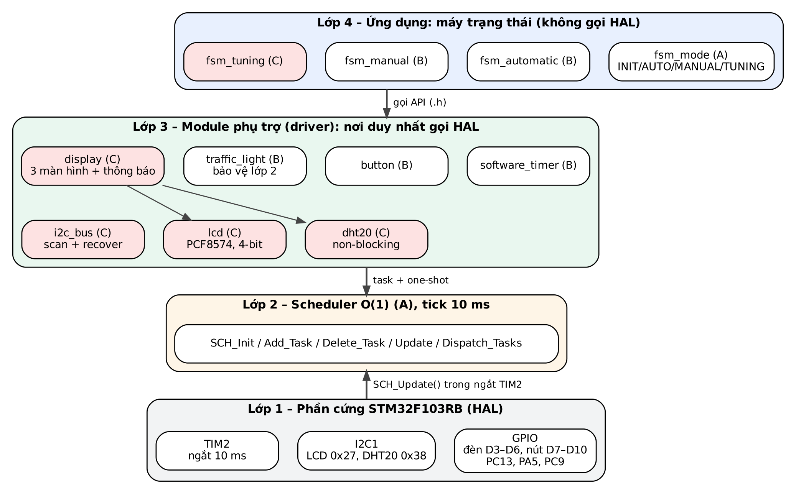
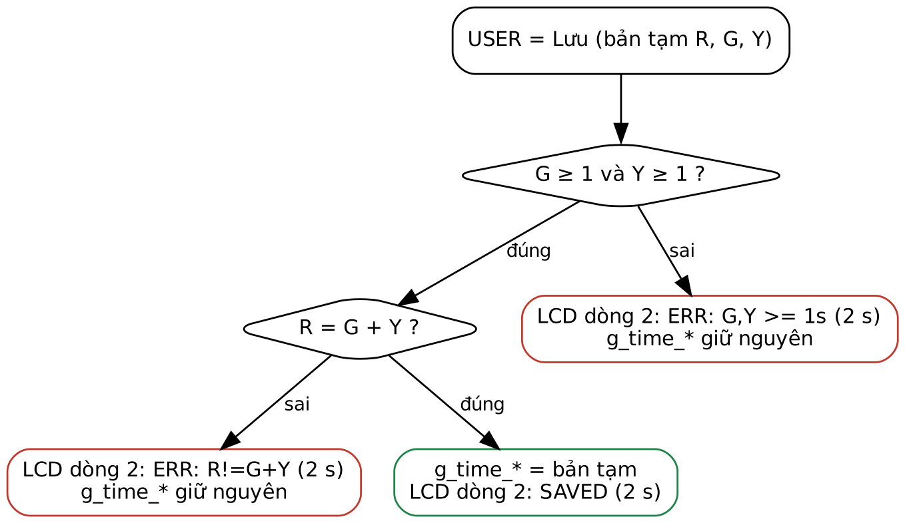
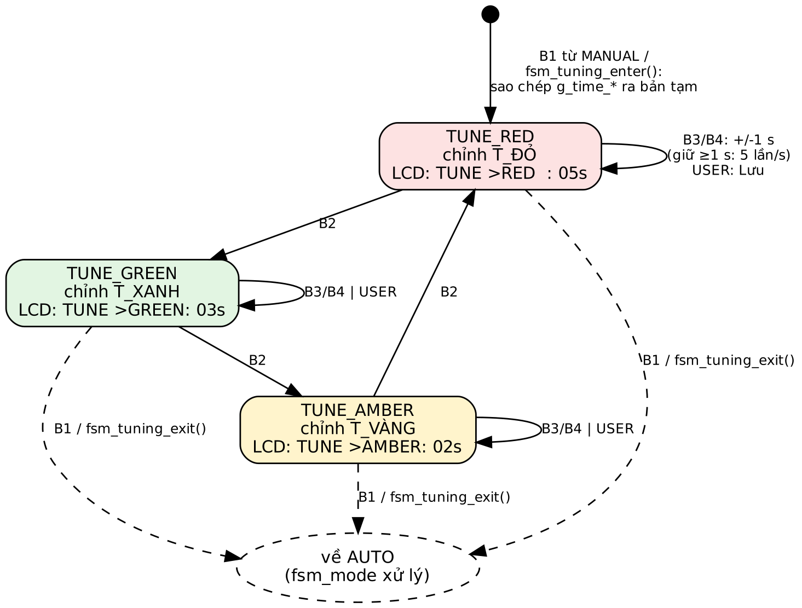

> **Ghi chú cho người ghép (xoá trước khi nộp):** các mục dưới đây đúng số mục của template. Chỗ **[CẦN ĐIỀN]** là số liệu phải lấy từ mạch thật ở lab. Bảng nút (2.1) theo bản đề xuất ở mục 2.1 của kế hoạch; nếu kickoff đã sửa thì sửa theo.

# 1. Giới thiệu dự án

## 1.2 Các chức năng của hệ thống

| STT | Chức năng | Mô tả | Thao tác / Nút nhấn |
|---|---|---|---|
| 1 | Chế độ tự động | Hai tuyến luân phiên theo chu trình ĐỎ–ĐỎ → Đỏ1–Xanh2 → Đỏ1–Vàng2 → Xanh1–Đỏ2 → Vàng1–Đỏ2, thời gian lấy từ `g_time_red/green/amber`. LCD đếm ngược từng tuyến. | Mặc định sau khởi động (ĐỎ–ĐỎ 2 s rồi vào AUTO) |
| 2 | Chế độ bằng tay | Giữ pha đang chạy; mỗi lần nhấn chuyển sang pha kế tiếp theo đúng chuỗi an toàn, khoá 1 s để chống bấm dồn. | B1 từ AUTO; B2 = pha kế |
| 3 | Chế độ chỉnh thời gian | Hai tuyến nháy Vàng. Chọn đèn Đỏ/Xanh/Vàng, tăng/giảm 1 s (giữ nút để chạy nhanh 5 lần/s), chỉnh trên bản tạm, Lưu có kiểm tra ràng buộc TĐ = TX + TV. | B1 từ MANUAL; B2 chọn; B3/B4 ±1 s; USER Lưu |
| 4 | Hiển thị nhiệt độ, độ ẩm | Đọc DHT20 mỗi 2 s, không chặn (trigger → chờ 80 ms bằng one-shot → đọc 7 byte có CRC). LCD dòng 2: `T:28.5C H:65.2%`; mất cảm biến quá 6 s hiện `--.-`. | Tự động ở INIT/AUTO/MANUAL |
| 5 | Mở rộng: trang cấu hình + báo lỗi an toàn | Nút USER ở AUTO/MANUAL đổi dòng 2 giữa T/H và giờ đang áp dụng (`SET R05 G03 Y02`). Khi lớp bảo vệ 2 ép ĐỎ–ĐỎ, dòng 1 hiện `SAFETY ERR`. | USER (AUTO, MANUAL) |

## 1.3 Sơ đồ khối hệ thống

Hệ thống chia 4 lớp, lớp trên chỉ dùng lớp dưới thông qua các hàm khai báo trong file `.h`. Ô màu hồng là phần do C phụ trách.

{width=16cm}

- **Lớp 1 – Phần cứng:** GPIO (2 module đèn D3–D6, 2 module nút D7–D10, nút USER PC13, LED PA5/PC9), I2C1 nối LCD và DHT20, TIM2 tạo ngắt 10 ms.
- **Lớp 2 – Scheduler O(1):** `SCH_Update()` được gọi trong ngắt TIM2; mọi công việc khác chạy thành task trong `SCH_Dispatch_Tasks()`.
- **Lớp 3 – Module phụ trợ:** nơi duy nhất được gọi `HAL_*`. Riêng `display` không gọi HAL mà chỉ dùng `lcd`, `dht20`, `software_timer`, `traffic_light`.
- **Lớp 4 – Máy trạng thái:** `fsm_mode` điều phối và gọi máy trạng thái của chế độ hiện tại. Không file `fsm_*.c` nào chứa `HAL_` (kiểm tra bằng `grep -n "HAL_" Core/Src/fsm_*.c`).

# 2. Thiết kế dự án

## 2.1 Tổng quan các chế độ hoạt động

**Khởi động (cấp nguồn/reset):** vào INIT, cả hai tuyến ĐỎ trong 2 s, nạp giờ mặc định Đỏ 5 s – Xanh 3 s – Vàng 2 s. LCD hiện `STARTING...`, dòng 2 hiện nhiệt độ/độ ẩm ngay khi có số liệu. Hết 2 s (one-shot `init_done`), hệ thống vào AUTO.

| Nút nhấn | Chế độ tự động | Chế độ bằng tay | Chế độ chỉnh thời gian |
|---|---|---|---|
| Nút 1 (D7) | Sang MANUAL | Sang TUNING | Về AUTO (dùng giá trị đã Lưu; chưa Lưu thì bỏ) |
| Nút 2 (D8) | – | Sang pha kế tiếp (khoá 1 s) | Chọn đèn cần chỉnh: ĐỎ → XANH → VÀNG → ĐỎ |
| Nút 3 (D9) | – | – | +1 s; giữ ≥ 1 s: tăng liên tục 5 lần/s |
| Nút 4 (D10) | – | – | −1 s; giữ ≥ 1 s: giảm liên tục 5 lần/s |
| Nút USER (PC13) | Đổi trang LCD (T/H ↔ giờ cấu hình) | Đổi trang LCD | Lưu (kiểm tra hợp lệ trước) |

Màn hình LCD 16×2 theo chế độ:

| Chế độ | Dòng 1 | Dòng 2 |
|---|---|---|
| INIT | `STARTING...` | `T:28.5C H:65.2%` |
| AUTO | `AUTO 1:R07 2:G05` | `T:28.5C H:65.2%` hoặc `SET R05 G03 Y02` |
| MANUAL | `MAN R1 - G2` | `T:28.5C H:65.2%` hoặc `SET R05 G03 Y02` |
| TUNING | `TUNE >RED  : 05s` | `R05 G03 Y02 *` (dấu `*`: chưa Lưu) |
| Thông báo 2 s | (giữ) | `SAVED` / `ERR: R!=G+Y` / `ERR: G,Y >= 1s` |

## 2.3 Phân tích chuyển đổi giữa các chế độ lớn

### 2.3.2 Từ chế độ bằng tay sang chế độ chỉnh thời gian

Sự kiện: nhấn B1 khi đang ở MANUAL. `fsm_mode` thực hiện hành động exit của MANUAL và entry của TUNING ngay trong lần chạy đó (một tick 10 ms).

1. **Đèn hai tuyến ngay sau khi chuyển:** cả hai tuyến chuyển sang Vàng nhấp nháy 1 Hz (Vàng–Vàng 0,5 s rồi Tắt–Tắt 0,5 s). Từ lúc vào TUNING đến lúc rời đi, không tuyến nào có Xanh. Vì vậy dù trước đó đang ở pha nào (kể cả R1G2), người dùng chỉnh giờ trong khi giao lộ ở trạng thái "cảnh báo", không cấp quyền đi cho tuyến nào.
2. **Timer và task trong scheduler:**
   - Thêm task `blink_amber` bằng `SCH_Add_Task(blink_amber, 0, 50)` (chu kỳ 500 ms) và lưu lại TaskID để xoá khi ra. Scheduler giữ nguyên TaskID khi thêm lại task tuần hoàn, nhờ vậy `SCH_Delete_Task(id)` lúc thoát luôn xoá đúng task.
   - Không dùng timer pha `TMR_PHASE` và timer khoá `TMR_MANUAL_LOCK` nữa: chế độ TUNING không chuyển trạng thái theo thời gian.
   - Gọi `button_clear_all()` để lần nhấn còn sót của MANUAL không "rò" sang TUNING (ví dụ lần nhấn B2 cuối cùng bị hiểu thành "chọn đèn").
   - Các task `display_update`, `lcd_flush`, `dht20_trigger` vẫn chạy bình thường.
3. **Biến đếm thời gian:** `fsm_tuning_enter()` sao chép `g_time_red/green/amber` (giờ đang áp dụng) ra bản tạm `s_tmp[3]` và đặt trạng thái về `TUNE_RED`. Mọi thao tác B3/B4 chỉ sửa bản tạm. `g_time_*` chỉ thay đổi khi người dùng nhấn Lưu và bản tạm hợp lệ.
4. **LCD:** dòng 1 đổi từ `MAN R1 - G2` sang `TUNE >RED  : 05s` (đèn đang chọn và giá trị của nó). Dòng 2 hiện cả ba giá trị `R05 G03 Y02`. Thông báo cũ (nếu có) bị xoá bằng `display_clear_message()`. LCD chỉ gửi các ký tự thực sự thay đổi, nên màn hình mới hiện sau ≤ 40 ms.
5. **An toàn (không bao giờ có 2 tuyến cùng Xanh):** trong TUNING chỉ dùng hai cặp Vàng–Vàng và Tắt–Tắt, cả hai đều nằm trong danh sách trắng của lớp bảo vệ 1. Mọi lệnh ghi đèn vẫn đi qua `traffic_set_pair()` (lớp bảo vệ 2), nên kể cả khi FSM có lỗi, một cặp có Xanh–Xanh vẫn bị ép về ĐỎ–ĐỎ. Lối ra duy nhất là về AUTO qua ĐỎ–ĐỎ 1 s (mục 2.3.3), nên chuyển từ Vàng nhấp nháy sang Xanh không bao giờ đi tắt qua một pha không an toàn.

### 2.3.3 Từ chế độ chỉnh thời gian về chế độ tự động

**a) Ràng buộc hợp lệ và xử lý khi người dùng nhập sai**

Gọi TĐ, TX, TV là thời gian Đỏ, Xanh, Vàng (giây). Trong chu trình tự động, tuyến 1 Đỏ đúng bằng khoảng thời gian tuyến 2 Xanh rồi Vàng, và ngược lại. Vì vậy bắt buộc:

- **TĐ = TX + TV.** Nếu TĐ lớn hơn, sẽ có khoảng cả hai tuyến cùng Đỏ mà chu trình không mô tả. Nếu TĐ nhỏ hơn, một tuyến hết Đỏ trong khi tuyến kia còn Xanh/Vàng, và đây là nguy hiểm.
- **TX ≥ 1, TV ≥ 1.** Pha 0 s nghĩa là bỏ qua pha Vàng: chuyển thẳng từ Xanh sang Đỏ, mất thời gian thoát giao lộ.
- **TĐ ≤ 99.** LCD chỉ hiển thị 2 chữ số. Khi chỉnh, mỗi giá trị bị kẹp trong [0, 99] (không quay vòng). Giá trị 0 vẫn cho chỉnh để có thể thử nghiệm và minh hoạ việc bắt lỗi khi Lưu.

{width=11cm}

Người dùng chỉ sửa trên bản tạm. Khi nhấn Lưu, `fsm_tuning_validate()` kiểm tra theo thứ tự trên:

- **Sai:** LCD dòng 2 hiện `ERR: R!=G+Y` hoặc `ERR: G,Y >= 1s` trong 2 s. Thông báo do one-shot `msg_clear` tự xoá. `g_time_*` giữ nguyên giá trị cũ. Bản tạm cũng được giữ để người dùng sửa tiếp, hệ thống vẫn ở TUNING. Giá trị sai vì vậy không bao giờ vào được chu trình tự động.
- **Đúng:** ghi bản tạm vào `g_time_*` và hiện `SAVED` 2 s. Vì TUNING không chạy chu trình đèn, giá trị mới thực sự có hiệu lực ở lần vào AUTO kế tiếp.
- Nếu có thông báo mới khi thông báo cũ còn hiện, one-shot cũ bị `SCH_Delete_Task` trước. Nếu không làm vậy, one-shot cũ sẽ xoá thông báo mới quá sớm.

**b) Năm câu hỏi trọng tâm khi nhấn B1 ở TUNING**

1. **Đèn hai tuyến:** ĐỎ–ĐỎ trong 1 s ("all-red clearance"), rồi vào pha đầu R1G2 với giờ mới.
2. **Timer và task:** `SCH_Delete_Task(blink_id)` xoá task nháy Vàng; thêm one-shot 1 s để kết thúc pha ĐỎ–ĐỎ; `timer_set(TMR_PHASE, …)` khởi tạo lại timer pha theo `g_time_*` mới; gọi `button_clear_all()`.
3. **Biến thời gian:** `fsm_tuning_exit()` bỏ bản tạm. Nếu chưa Lưu, giờ đang áp dụng không đổi. Lần vào TUNING sau sẽ sao chép lại từ `g_time_*`. Không có bước "áp dụng" riêng, vì Lưu đã ghi thẳng vào `g_time_*` sau khi kiểm tra hợp lệ.
4. **LCD:** thông báo đang hiện (nếu có) bị xoá; dòng 1 chuyển sang `AUTO 1:R01 2:R01` trong pha ĐỎ–ĐỎ, rồi `AUTO 1:R05 2:G03` (đếm ngược theo giờ mới); dòng 2 về `T:… H:…`.
5. **An toàn:** đi từ Vàng nhấp nháy sang Xanh luôn phải qua 1 s ĐỎ–ĐỎ. Chu trình mới dùng giờ đã qua kiểm tra TĐ = TX + TV, nên ở mọi thời điểm, tuyến đang Xanh/Vàng có tuyến kia Đỏ. Lớp bảo vệ 2 vẫn chặn ở tầng driver.

# 3. Hiện thực dự án

## 3.3 Hiện thực các module phụ trợ

### 3.3.4 DHT20 và LCD (I2C)

**Kết nối:** cả hai thiết bị nối chung bus I2C1, chế độ Standard 100 kHz.

| Thiết bị | Địa chỉ 7-bit | Địa chỉ trong HAL (dịch trái 1) | Ghi chú |
|---|---|---|---|
| DHT20 | 0x38 | 0x70 | Cố định |
| LCD (PCF8574) | **[CẦN ĐIỀN]** (thường 0x27) | 0x4E | `lcd_init()` tự dò 0x27, 0x3F, 0x20–0x26, 0x39–0x3E |

**DHT20 – đọc không chặn (non-blocking).** Code mẫu gọi `HAL_Delay(80)` giữa lệnh đo và lệnh đọc. Cách này chặn cả vòng `SCH_Dispatch_Tasks()` suốt 8 tick, và vì `SCH_Update` O(1) chỉ trừ Delay của task đầu, cả danh sách task bị trễ theo. Nhóm tách việc đọc thành 2 pha:

1. `dht20_init()` chạy một lần trước khi scheduler chạy: chờ ≥ 100 ms từ lúc cấp nguồn, đọc byte trạng thái. Nếu `(status & 0x18) != 0x18` thì khởi tạo lại 3 thanh ghi 0x1B, 0x1C, 0x1E theo quy trình của nhà sản xuất.
2. Task `dht20_trigger` (chu kỳ 2 s) gửi `0xAC 0x33 0x00`, rồi tự thêm one-shot `SCH_Add_Task(dht20_read, 8, 0)`, tức đọc sau 80 ms.
3. One-shot `dht20_read` đọc 7 byte `[trạng thái][RH 20 bit][T 20 bit][CRC]`:
   - Nếu bit 7 của byte trạng thái bằng 1 (còn đang đo), đọc lại sau 1 tick, tối đa 3 lần.
   - Kiểm tra CRC-8 (đa thức 0x31, giá trị đầu 0xFF) trên 6 byte đầu. Sai CRC thì bỏ số liệu và giữ giá trị cũ.
   - 3 chu kỳ liên tiếp thất bại thì `dht20_get()` trả 0 và LCD hiện `--.-`.
   - 5 lỗi I2C liên tiếp thì tự gọi `i2c_bus_recover()`.

**Công thức chuyển đổi** (S_RH, S_T là số 20 bit):

::: center
RH = S_RH / 2^20 × 100 %          T = S_T / 2^20 × 200 − 50 (°C)
:::

Để không cần số thực (newlib-nano mặc định không in được `%f`), kết quả được lưu dạng số nguyên ×10 và làm tròn:

```c
*rh_x10   = (uint16_t)((s_rh * 1000UL + (1UL << 19)) >> 20);          /* 652 = 65.2 %  */
*temp_x10 = (int16_t)((int32_t)((s_t * 2000UL + (1UL << 19)) >> 20) - 500); /* 285 = 28.5 C */
```

Vì S ≤ 2^20 − 1, tích S × 2000 < 2,1·10^9 vẫn nằm trong `uint32_t`, không bị tràn.

**LCD – bộ đệm khung và flush có giới hạn thời gian.** LCD HD44780 nối qua PCF8574 ở chế độ 4-bit, bản đồ bit P0 = RS, P2 = EN, P3 = đèn nền, P4–P7 = D4–D7. Mỗi ký tự là 2 nibble, mỗi nibble 2 byte (EN = 1 rồi EN = 0), tổng 4 byte I2C ≈ 0,36 ms ở 100 kHz. Nếu ghi cả màn hình bằng cách gọi từng ký tự như code mẫu, mất khoảng 15 ms, dài hơn 1 tick. Nhóm thiết kế lại như sau:

- `lcd_print_line(row, s)` chỉ chép chuỗi vào bộ đệm RAM `s_want` (đệm khoảng trắng đủ 16 ký tự, ghi đè). Hàm này không gửi I2C, nên được gọi tuỳ ý.
- Task `lcd_flush` (10 ms) so `s_want` với `s_shown` (nội dung đang nằm trên LCD), rồi gửi **một** giao dịch I2C gồm lệnh đặt con trỏ và tối đa 8 ký tự khác nhau, ≤ 36 byte ≈ 3,4 ms.
- Đếm ngược đổi 2 chữ số chỉ tốn 12 byte ≈ 1,2 ms. Không bao giờ gọi lệnh clear định kỳ: lệnh clear mất 1,52 ms và làm màn hình nhấp nháy.

| Module | File | Các hàm chính (API) |
|---|---|---|
| DHT20 | `dht20.h / .c` | `dht20_init()`, `dht20_trigger()` (task 2 s), `dht20_read()` (one-shot), `dht20_get(&t_x10, &rh_x10)`, `dht20_last_status()` |
| LCD | `lcd.h / .c` | `lcd_init()`, `lcd_print_line(row, s)`, `lcd_flush()` (task 10 ms), `lcd_flush_all()`, `lcd_get_address()` |
| Giao diện | `display.h / .c` | `display_update()` (task 250 ms), `display_show_message(msg, ms)`, `display_clear_message()`, `display_next_page()`, `display_set_tuning(...)` |
| Bus I2C | `i2c_bus.h / .c` | `i2c_bus_scan()`, `i2c_bus_recover()`: thoát lỗi kẹt BUSY của I2C trên STM32F1 bằng 9 xung SCL + STOP + SWRST |

Task của phần C trong scheduler (tick 10 ms):

| Task | Delay (ms) | Period (ms) | Mô tả |
|---|---|---|---|
| `display_update` | 30 | 250 | Vẽ lại 2 dòng theo chế độ vào bộ đệm |
| `lcd_flush` | 50 | 10 | Gửi tối đa 8 ký tự thay đổi (≤ 3,4 ms) |
| `dht20_trigger` | 1000 | 2000 | Gửi lệnh đo, thêm one-shot đọc |
| `dht20_read` (one-shot) | 80 | 0 | Đọc 7 byte, kiểm tra busy và CRC |
| `msg_clear` (one-shot) | 2000 | 0 | Xoá thông báo SAVED/ERR |

## 3.4 Thiết kế máy trạng thái

### 3.4.3 Máy trạng thái chế độ chỉnh thời gian

{width=12cm}

Trạng thái của `fsm_tuning` là đèn đang được chọn để chỉnh. Trong mọi trạng thái, hai tuyến đều Vàng nhấp nháy do task `blink_amber` của `fsm_mode` điều khiển.

| Trạng thái | Tuyến 1 | Tuyến 2 | Sự kiện | Hành động | Trạng thái kế |
|---|---|---|---|---|---|
| (vào) | Vàng nháy | Vàng nháy | B1 từ MANUAL | `fsm_tuning_enter()`: chép `g_time_*` ra bản tạm | TUNE_RED |
| TUNE_RED | Vàng nháy | Vàng nháy | B2 | – | TUNE_GREEN |
| TUNE_GREEN | Vàng nháy | Vàng nháy | B2 | – | TUNE_AMBER |
| TUNE_AMBER | Vàng nháy | Vàng nháy | B2 | – | TUNE_RED |
| bất kỳ | Vàng nháy | Vàng nháy | B3 / giữ B3 | bản tạm[đang chọn] + 1, kẹp ≤ 99 | giữ nguyên |
| bất kỳ | Vàng nháy | Vàng nháy | B4 / giữ B4 | bản tạm[đang chọn] − 1, kẹp ≥ 0 | giữ nguyên |
| bất kỳ | Vàng nháy | Vàng nháy | USER | kiểm tra hợp lệ → `SAVED` hoặc `ERR` (2 s) | giữ nguyên |
| bất kỳ | ĐỎ–ĐỎ 1 s | ĐỎ–ĐỎ 1 s | B1 | `fsm_tuning_exit()`, `fsm_mode` về AUTO | (AUTO) |

## 3.5 Hiện thực máy trạng thái – phần `fsm_tuning`

`fsm_tuning.c` không có lệnh HAL nào. File chỉ đọc nút qua `button.h`, hiển thị qua `display.h` và ghi giờ vào `global.h`. Hàm `fsm_tuning_run()` được `fsm_mode_run()` gọi khi `g_mode == MODE_TUNING`, và không xử lý B1 (B1 thuộc FSM chuyển chế độ).

```c
void fsm_tuning_run(void)
{
    switch (s_state) {
    case TUNE_RED:
        handle_edit(TUNE_RED);                 /* B3/B4: +/-1 s, USER: Luu */
        if (button_pressed(BTN_2)) { s_state = TUNE_GREEN; refresh_display(); }
        break;
    case TUNE_GREEN:
        handle_edit(TUNE_GREEN);
        if (button_pressed(BTN_2)) { s_state = TUNE_AMBER; refresh_display(); }
        break;
    case TUNE_AMBER:
        handle_edit(TUNE_AMBER);
        if (button_pressed(BTN_2)) { s_state = TUNE_RED;   refresh_display(); }
        break;
    default:                                   /* trang thai la => ve trang thai an toan */
        s_state = TUNE_RED; refresh_display();
        break;
    }
}

tune_result_t fsm_tuning_validate(uint8_t red, uint8_t green, uint8_t amber)
{
    if (green < 1U || amber < 1U)                          return TUNE_ERR_MIN;
    if (red > TUNE_VALUE_MAX)                              return TUNE_ERR_MAX;
    if ((uint16_t)red != (uint16_t)green + (uint16_t)amber) return TUNE_ERR_SUM;
    return TUNE_OK;
}
```

Nhấn giữ được xử lý bằng `button_pressed(BTN_3) || button_held(BTN_3)`. Module button của B trả `button_held()` = 1 ở mốc giữ 1 s và sau đó mỗi 200 ms, nên FSM không cần tự đếm thời gian.

**Quy ước đặt tên trong phần C:** tên file viết thường, nối bằng gạch dưới (`fsm_tuning.c`); tên hàm theo dạng `<module>_<hành_động>()` (`dht20_trigger`, `lcd_print_line`); enum có tiền tố module (`TUNE_RED`, `DHT20_ST_OK`); hằng số viết hoa (`TUNE_VALUE_MAX`, `LCD_FLUSH_MAX_CHARS`); biến `static` của module có tiền tố `s_`, biến toàn cục có tiền tố `g_`. Chú thích trong code viết không dấu để tránh lỗi mã hoá trong STM32CubeIDE.

# 4. Kết quả và đánh giá

## 4.1 Kết quả đạt được

| Hạng mục | Cách kiểm tra | Kết quả |
|---|---|---|
| I2C scan thấy 2 thiết bị | Lab 1, breakpoint mảng `found` | **[CẦN ĐIỀN]** |
| LCD in chuỗi, không nhấp nháy | Lab 1–2, quan sát | **[CẦN ĐIỀN]** |
| DHT20 cập nhật mỗi 2 s, hà hơi thì độ ẩm tăng | Lab 2 | **[CẦN ĐIỀN]** |
| Giá trị DHT20 hợp lý (20–40 °C, 30–90 %) | Lab 1–2, so với nhiệt kế phòng | **[CẦN ĐIỀN]** |
| Đếm ngược trên LCD khớp đèn thật | Lab 2–3, quay video | **[CẦN ĐIỀN]** |
| Không task nào của C chạy quá 1 tick | Tính toán + test PC: giao dịch I2C lớn nhất 36 byte ≈ 3,4 ms | Đạt (test PC) |
| Công thức DHT20, CRC-8 | Test PC: vector tính tay (RH 50,0 %, T 30,0 °C), giá trị kiểm tra CRC chuẩn 0xF7 | Đạt (test PC) |
| Sai CRC / cảm biến chậm / mất cảm biến | Test PC giả lập DHT20: giữ giá trị cũ, đọc lại khi busy, hiện `--.-` sau 6 s, tự phục hồi | Đạt (test PC) |
| Tuning: nhập sai, giá trị biên 0 và 99 | Test PC + lab 3 | Đạt (test PC); lab **[CẦN ĐIỀN]** |
| Chạy liên tục 30 phút, số task ổn định | Test PC mô phỏng 180 000 tick: số task ổn định, không rò rỉ | Đạt (test PC); lab **[CẦN ĐIỀN]** |
| Không có `HAL_` trong `fsm_*.c` | `grep -n "HAL_" Core/Src/fsm_*.c` | Đạt |
| Build không warning | `arm-none-eabi-gcc -Wall -Wextra -Wconversion` với HAL STM32F1 | Đạt, 0 warning |

## 4.2 Hạn chế và hướng phát triển

**Hạn chế**

- I2C dùng chế độ polling: mỗi lần `lcd_flush` chiếm CPU tới 3,4 ms. Hệ thống vẫn đúng giờ vì mỗi lần dưới 1 tick, nhưng CPU không làm việc khác trong lúc đó.
- Giờ đã Lưu chỉ nằm trong RAM: reset mạch là quay về 5–3–2 s.
- Ở pha ĐỎ–ĐỎ, đếm ngược của cả hai tuyến hiện thời gian còn lại của pha ĐỎ–ĐỎ, không phải tổng thời gian Đỏ còn lại của tuyến sẽ chờ tiếp.
- Người dùng phải tự tính TĐ = TX + TV. Nhập sai chỉ bị báo lỗi khi Lưu.
- PCF8574 chỉ đảm bảo 100 kHz, nên không tăng tốc bus lên 400 kHz.

**Hướng phát triển**

- Dùng `HAL_I2C_Master_Transmit_DMA` hoặc `_IT` cho LCD để giải phóng CPU trong lúc gửi.
- Lưu giờ vào Flash (giả lập EEPROM trên trang Flash cuối) để giữ qua reset.
- Trong TUNING, tự tính TĐ = TX + TV khi người dùng chỉnh Xanh/Vàng, để không thể nhập sai ràng buộc.
- Hiển thị cảnh báo nhiệt độ/độ ẩm vượt ngưỡng, hoặc gửi số liệu qua UART.
